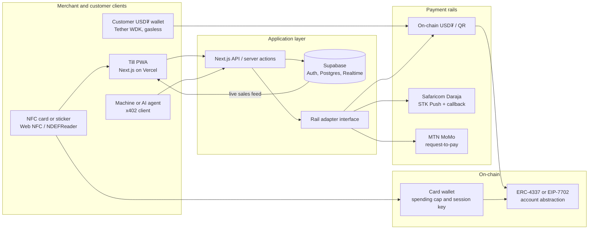

# Tilla

**One till, every wallet.**

> **Working name.** *Tilla* is a provisional project name and has not been cleared for trademark or domain conflicts. It may change before a public launch.

Tilla turns an ordinary Android phone into a free, zero-hardware merchant till. A customer can tap an NFC card or sticker, scan a QR code, or approve an M-Pesa or MTN MoMo prompt. Every confirmed payment is shown in large type and announced aloud the moment the payment network confirms it. The merchant can hold the balance in USD₮ or cash out to mobile money. The same till accepts payments from machines and AI agents.

This repository is being prepared for the **W3Node Node Engine** hackathon in Cape Town, **12–14 November 2026**, on the **Merchant & Machine Payments** track.

**Team:** Usman Olukayode.

## The problem

Everyday commerce in much of Sub-Saharan Africa is still cash-first, even where person-to-person mobile money is mature.

- Only **20% of adults in Sub-Saharan Africa made a digital merchant payment in 2024**, compared with **42% of adults globally**. In Nigeria, **42% of businesses name payment failures as a key concern**, and even a **1% merchant discount rate can feel punitive** for micro-merchants operating on thin margins. ([CGAP, on Global Findex 2025](https://www.cgap.org/blog/breaking-cash-habit-urgent-need-to-accelerate-digital-merchant-payments))
- Among mobile-money providers in Sub-Saharan Africa, **NFC is accepted for proximity payments by only 6%**, against **USSD (62%)** and **QR codes (37%)**. Mobile-money merchant payments were about **US$5.8 billion a month** in 2024. ([GSMA, State of the Industry Report on Mobile Money 2025, regional cuts](https://www.gsma.com/solutions-and-impact/connectivity-for-good/mobile-for-development/wp-content/uploads/2025/10/SOTIR-2025-Regional-Cuts_r-1.pdf))
- Card tap-to-pay is arriving unevenly. In South Africa, Yoco’s Tap to Pay on iPhone is priced from **2.5% plus a R2.99 payout fee**. Kenya has **no Apple Tap to Pay**, Apple Pay is not live there, and Safaricom’s planned M-Pesa tap-to-pay is described as Android-only. ([tech-ish, May 2026](https://tech-ish.com/2026/05/12/apple-tap-to-pay-south-africa-kenya-still-waits/))

Informal merchants therefore juggle cash, bank-transfer screenshots and a single-network till number. Fake alerts and failed payments cost them money; card terminals and exclusive SoftPOS apps are expensive or limited to one rail.

## The solution

Tilla is a **multi-rail merchant till** with a stablecoin settlement layer:

1. **One interface** for NFC tap, QR and mobile-money request-to-pay.
2. **Voice and visual confirmation** tied to the payment network or an on-chain receipt — not a customer screenshot.
3. **USD₮ balances** for merchants who want a dollar store of value, with an optional auto-save and a one-tap cash-out path to M-Pesa or MoMo.
4. **Machine and agent payments** on the same till, via an HTTP 402 / x402-style pay-per-request endpoint.

The product is designed to work anywhere mobile money or stablecoins exist, and is aimed first at African informal and small merchants.

## Core user flow

1. The merchant opens Tilla on an Android phone and enters an amount (for example, R50 or ₦2,000).
2. The customer pays in one of three ways:
   - taps a **Tilla NFC card or sticker** and enters a PIN (no smartphone required);
   - scans a **QR code** from any compatible USD₮ wallet; or
   - approves an **M-Pesa STK Push** or **MTN MoMo request-to-pay** on their own phone.
3. The payment rail confirms. The till shows a large **✓ PAID** state and **speaks the amount and payer** (“Received fifty rand from Thabo”).
4. The merchant’s balance sits in **USD₮**. They can auto-save a percentage and cash out to mobile money in one tap.
5. In **machine mode**, a vending machine, charger or AI agent pays the same till through the x402 endpoint. The payment appears in the same live sales feed.

## Architecture



A fuller design, including the rail abstraction, NFC custody model and x402 flow, is in [`docs/WHITEPAPER.md`](docs/WHITEPAPER.md). Product requirements are in [`docs/PRD.md`](docs/PRD.md).

## Tech stack

| Layer | Choice |
| --- | --- |
| Application | Next.js (App Router), TypeScript, deployed on [Vercel](https://vercel.com/) |
| Data and auth | [Supabase](https://supabase.com/) (Postgres, Auth, Realtime) |
| Wallets | [Tether Wallet Development Kit (WDK)](https://docs.wdk.tether.io/), including [`@tetherto/wdk-wallet-evm-erc-4337`](https://docs.wdk.tether.io/sdk/wallet-modules/) or `wdk-wallet-evm-7702-gasless` so customers need not hold gas |
| NFC | [Web NFC (`NDEFReader`)](https://developer.chrome.com/docs/capabilities/nfc) — Chrome on Android, HTTPS, user gesture required |
| Mobile money | Safaricom [Daraja](https://developer.safaricom.co.ke/) STK Push sandbox; [MTN MoMo request-to-pay](https://github.com/momoopenapi/momoopenapi_sandbox) sandbox |
| Voice | Browser `speechSynthesis` |
| Machine payments | x402-style HTTP 402 middleware and on-chain USD₮ settlement |
| Contracts (as needed) | Solidity and [Foundry](https://book.getfoundry.sh/) |
| Voice of the product | British English in documentation; merchant UI starts in English, with Pidgin and isiXhosa labels as a stretch goal |

## Planned repository structure

The application has not been scaffolded yet. The intended layout is:

```
tilla/
├── README.md
├── LICENSE
├── CONTRIBUTING.md
├── docs/
│   ├── PRD.md
│   └── WHITEPAPER.md
├── apps/
│   └── web/                 # Next.js till, checkout and dashboard
├── packages/
│   ├── rails/               # Payment-rail adapters (QR, Daraja, MoMo, x402)
│   └── ui/                  # Shared design tokens and till components
├── contracts/               # Foundry project: card wallet, caps, session keys
├── supabase/                # Schema, policies and edge functions
└── .gitignore
```

## Getting started

> **TODO — placeholders only.** The application and contracts have not been initialised. The commands below are the intended developer path and will fail until the scaffold exists. Do not treat them as working instructions yet.

```bash
# TODO: clone this repository
git clone <repository-url>
cd tilla

# TODO: install dependencies (package manager to be confirmed)
pnpm install

# TODO: copy environment template and fill in local values
cp apps/web/.env.example apps/web/.env.local
# Required once scaffolded, among others:
#  NEXT_PUBLIC_SUPABASE_URL=
#  NEXT_PUBLIC_SUPABASE_ANON_KEY=
#  SUPABASE_SERVICE_ROLE_KEY=
#  DARAJA_CONSUMER_KEY=
#  DARAJA_CONSUMER_SECRET=
#  DARAJA_PASSKEY=
#  DARAJA_SHORTCODE=
#  MOMO_SUBSCRIPTION_KEY=
#  MOMO_API_USER=
#  MOMO_API_KEY=
#  WDK / paymaster configuration

# TODO: start the Next.js app
pnpm --filter web dev

# TODO: apply the Supabase schema locally
# supabase start && supabase db reset

# TODO: build and test contracts
cd contracts && forge test
```

NFC demos require **Chrome on Android** over HTTPS (or localhost with the appropriate flags). Bring physical NFC tags to any live demo. Record a backup video in case a sandbox callback fails.

## Roadmap (three-day hackathon scope)

| Priority | Scope |
| --- | --- |
| **Must have** | QR and NFC USD₮ payments via WDK; one live mobile-money sandbox (M-Pesa STK Push); Realtime till with voice confirmation; merchant dashboard; public deployment on Vercel |
| **Nice to have** | x402 AI-agent or machine payment; MTN MoMo request-to-pay; auto-save; cash-out quote through a licensed ramp API; PDF sales statement |
| **Later** | Offline-signed authorisations; additional languages; hardware device wallets; credit based on sales history |

Day-by-day milestones and MoSCoW requirements are in the [PRD](docs/PRD.md).

## Hackathon

| | |
| --- | --- |
| Event | W3Node Node Engine, Cape Town |
| Dates | 12–14 November 2026 |
| Venue | Parkview Event Space, Woodstock, Cape Town |
| Track | Merchant & Machine Payments — “Onchain infrastructure for tap-to-pay, e-commerce wallets, and point-of-sale transactions.” ([w3node.io/node-engine](https://w3node.io/node-engine)) |
| Judging (track dashboard) | Product design 33% · Technical UX 34% · Business / market fit 33% |
| Official site | [w3node.io](https://w3node.io/) |

Sponsorship quests were listed as “Coming Soon” on the official page; the build should stay flexible enough to target a confirmed chain bounty at kick-off.

## Licence

[MIT](LICENSE) © 2026 Usman Olukayode.

## Further reading

- [Product requirements](docs/PRD.md)
- [White paper](docs/WHITEPAPER.md)
- [Contributing](CONTRIBUTING.md)
